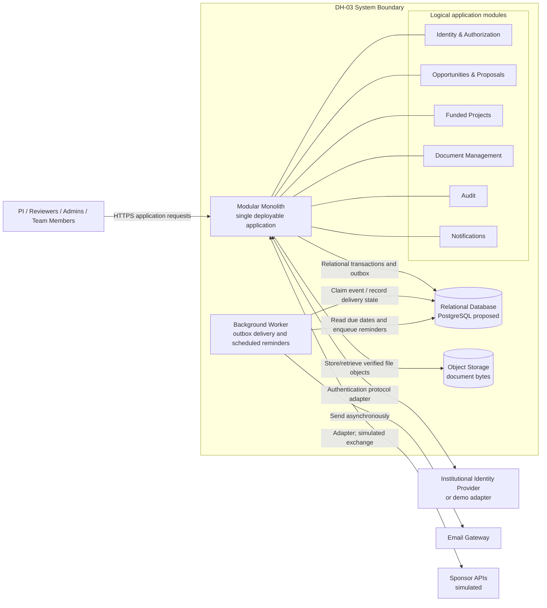

# Container View

## Notes

The logical modules are not separate deployable services. The worker is a separately scheduled/runtime process that shares application contracts and persistence; it does not bypass module rules. PostgreSQL and object storage are proposed technologies, not procurement decisions. See [AD-01](../adr/AD-01-modular-monolith.md), [AD-04](../adr/AD-04-relational-object-storage.md), and [AD-06](../adr/AD-06-event-notifications.md).
