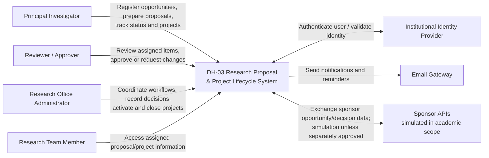

# Context View

## Boundary notes

- Authentication delegation depends on provider availability; OIDC is only a candidate. A demonstration adapter must not be presented as production institutional SSO.
- Sponsor APIs are shown as external context but real portal submission is out of scope; integration is simulated in the initial academic scope.
- Email delivery is external and asynchronous; temporary failure must not roll back the business operation.
- Users and resource visibility are governed by server-side policies in [AD-02](../adr/AD-02-identity-authorization.md).
