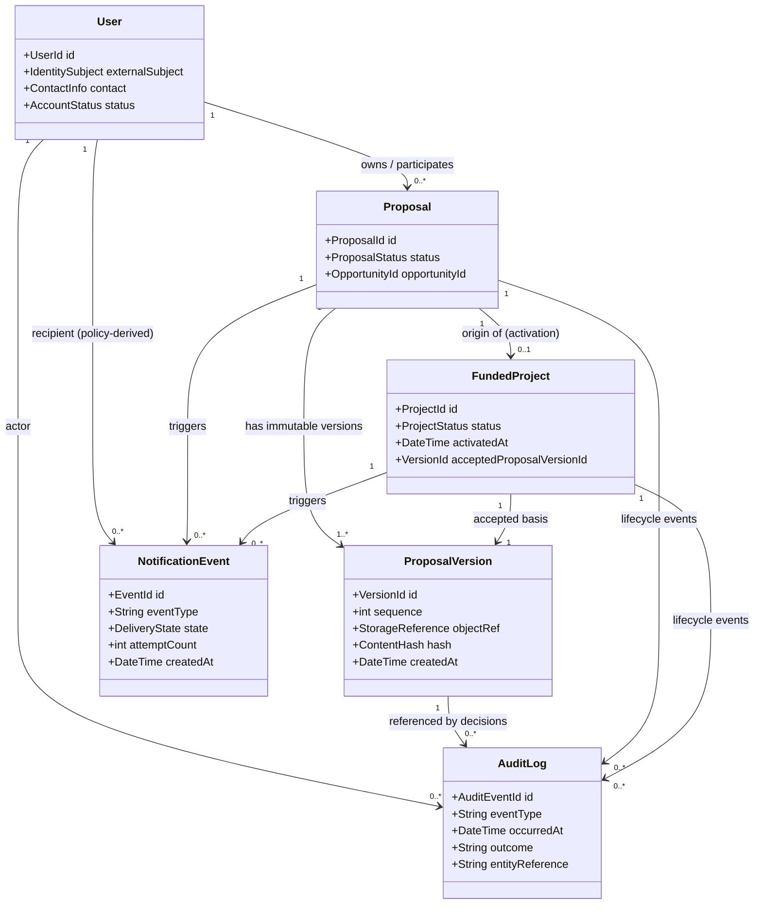

# Domain Model View

## Interpretation

The diagram is conceptual, not a complete schema. `User` relationships to proposals/projects must be modeled with explicit membership, role, or assignment records in persistence; the diagram summarizes those associations. `ProposalVersion` refers to document versions associated with proposal evidence; a complete document model may include a logical `Document` aggregate. Audit and notification events reference an affected entity and may reference a specific version. The accepted version is explicit and must not be inferred from recency. See [domain and data contracts](../design/domain-and-data.md).
